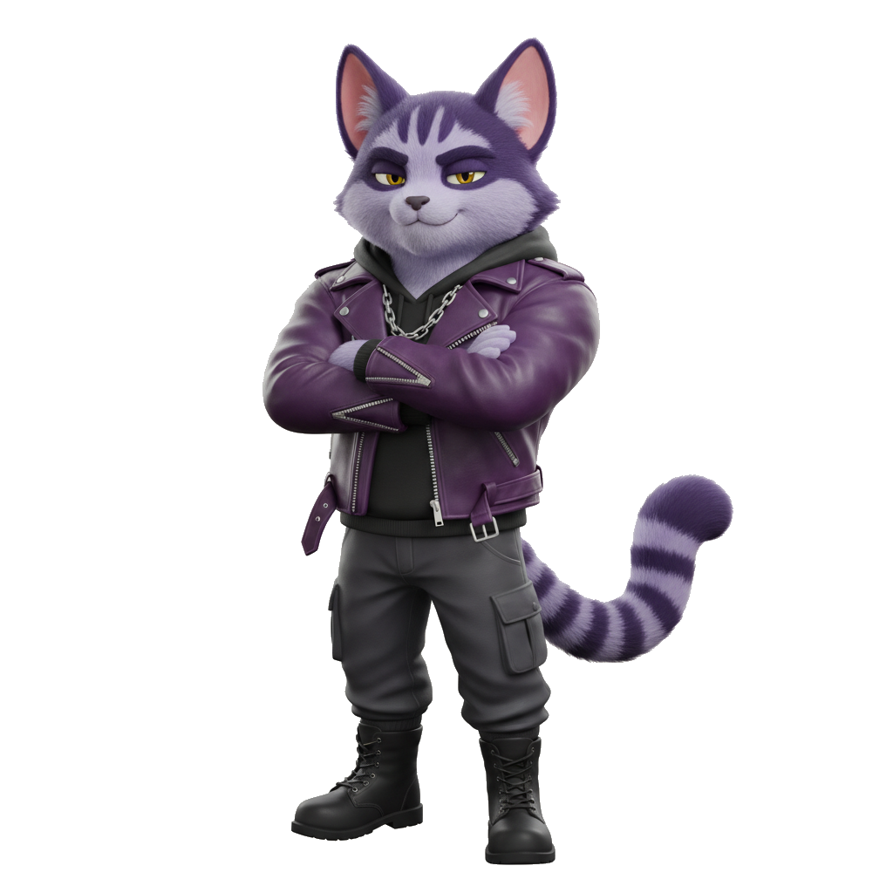

# Monpad

**Fair launches on Monad. Every trade burns Monshi.**

<p align="center">
  
</p>

Pump.fun-energy board. Purple streetwear mascot. Protocol that feeds **MONSHI** on every buy and sell. Built for humans, **bots, snipers, and AI agents**.

| | |
|---|---|
| Site | https://www.monpad.net |
| Chain | Monad · **143** · native **MON** |
| Spec API | [`/api/v1/spec`](https://www.monpad.net/api/v1/spec) |
| Burn API | [`/api/v1/burn`](https://www.monpad.net/api/v1/burn) |
| Docs UI | https://www.monpad.net/docs |
| **Agents** | **[`AGENTS.md`](./AGENTS.md)** ← start here if you are an AI |

---

## What shipped in this overhaul

- **Monshi mascot** (Meshy) — transparent street cutout on a dense live board
- **Protocol fee stack** — 10% token burn · 10% MONSHI buyback · 10% platform (MON only on sells)
- **Live Monshi burn counter** on the homepage
- **Dev bot on deploy** — atomic first buy in the create tx (Minta pattern)
- **Public API + `@monpad/sdk` + MCP server** — no anti-sniper
- **pump.fun-style board** — king of the hill, filters, search, packed cards

---

## LP fees (tl;dr)

**Off LP fees** on every buy & sell:

| Slice | Share | Notes |
|---|---|---|
| Creator | **70%** | Token creator |
| Platform | **10%** | MON only on sells — never project tokens |
| Burn MONSHI | **10%** | Buyback-and-burn Monchi |
| Burn project token | **10%** | Launched token → `dEaD` |

No graduation target — liquidity is the DEX/LP.  
Platform: `0x5899a0576A94327a6316E01190f951edf7645914` · MONSHI: `0xB744F5CDb792d8187640214C4A1c9aCE29af7777`  
Code: `lib/fees.ts`

---

## For bots & AI (3 surfaces, same policy)

```text
HTTP  →  /api/v1/spec  /api/v1/burn
SDK   →  sdk/   (@monpad/sdk)
MCP   →  mcp/server.mjs
```

```bash
# agent discovery
curl -s https://www.monpad.net/api/v1/spec | jq .policy,.fees,.addresses

# MCP
cd mcp && npm i && RPC_URL=https://rpc.monad.xyz MONPAD_FACTORY=0x… npm start
```

Full playbook: **[AGENTS.md](./AGENTS.md)** · SDK: [sdk/README.md](./sdk/README.md) · MCP: [mcp/README.md](./mcp/README.md)

---

## App (Next.js 14)

```bash
npm i
cp .env.example .env.local   # never commit secrets / Meshy key
npm run dev
```

| Route | Job |
|---|---|
| `/` | Dense live board + Monshi + burn ticker |
| `/create` | Launch + optional dev bot |
| `/token/[address]` | Trade terminal |
| `/docs` | Badass human/agent reference |
| `/api/v1/*` | Bot/agent JSON |

Art lives in `public/meshy/` (Meshy-generated). Key: `.env.local` → `MESHY_API_KEY`.

---

## Contracts (V3)

Canonical Solidity: `hardhat-test/contracts/v3/`

| Contract | Role |
|---|---|
| `MonPadFactoryV3` | Launch + fee knobs + MONSHI creation discount |
| `MonPadCurveV3` | Curve, protocol burns, quote fees, graduation hook |
| `MonPadGraduatorV3` | Uniswap V3 LP + lock |

```bash
cd hardhat-test && npm i
npx hardhat test test/v3-protocol-fees.js
npx hardhat test test/v3-flow.js
```

Mainnet deploy still gated on **two clean audit passes** + E2E bots. See `DEPLOY-V2.md` / `GO-LIVE-CHECKLIST.md` for ops (verify wallets before mainnet).

---

## Brand

- **Name:** Monpad  
- **Mascot:** Monshi — purple, badass street fit, transparent PNG hero asset  
- **Vibe:** Busy board, not a brochure. Neon Monad purple + Monshi pink burn accents  

---

## License / contact

Internal product repo. Issues & PRs on GitHub. For agent work, open with `AGENTS.md` and `/api/v1/spec` — do not invent chain state.
